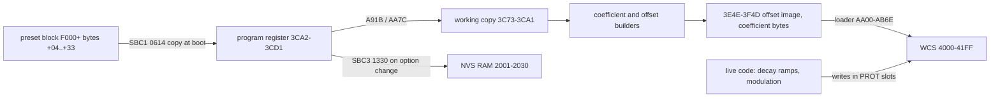

# Lexicon 224XL V8.2 program parameters (sliders and options)

This document covers how the V8.2 firmware stores the LARC slider parameters and the three on/off options (DYN DECAY, MODE ENH, DECAY OPT), and how it turns them into DSP microcode. Most results are for CONCERT HALL (program 01).

**Method.** Findings come from static disassembly plus differential runs of the real firmware in the `emu/` machine:
- change one byte of a preset block in a copy of the ROM image (`lexprobe` patches, or `tools/rom_patch.py` for renders);
- boot, and diff the WCS (DSP program RAM) and the SBC RAM (`lexprobe diff`);
- run noise bursts or impulses through the DSP at its own rate, and trace the firmware's live WCS writes, its X-register reads and selected program-counter hits (`lexprobe run`, `access`, `handlers`);
- measure the output: RT60 from a T20 fit on the Schroeder integral, normalised echo density (NED, 20 ms windows), and tail spectra.

The tools are described in [tools/README.md](../tools/README.md). The RT60 and NED analyses were one-off scripts and are not kept.

Times and rates of the firmware's live behaviour (modulation updates, level ticks, ramps) depend on how fast the emulated 8080 runs. They are measured with one wait state per off-board machine cycle (`Machine::kWaitStates`, `[INFERENCE]`, see [dsp_microcode.md](dsp_microcode.md)); without it they run about 16% faster.

Step numbers are 8080 step numbers *n* (WCS byte 4000h + 4*n*); the DSP program counter is pc = 127 − *n*, which is how `tools/ucode_dump.py` lists steps. "m" is the 6-bit coefficient magnitude, so the gain is m/32 (see [dsp_microcode.md](dsp_microcode.md)).

## 1. Data path

- **Preset block** (the 24 blocks from F000; see [rom_map.md](rom_map.md) §4):
  - +04 is the microcode ID;
  - each byte +05…+33 is one parameter;
  - bytes +35 onward changed nothing at boot `[unknown]`.
- **Program register.** The boot copy (`0614`: *(HL) → (DE)*, B bytes) puts +04…+33 at 3CA2–3CD1. The preset byte at offset *k* therefore lands at 3CA3 + (*k* − 5); 3CA2 is the microcode ID.
- **Working copy.** A second copy at 3C73–3CA1 is written by A91B and AA7C `[INFERENCE: the copy the builders consume]`.
- **Saved copy.** SBC3 1330 copies the 48 bytes 3CA2–3CD1 to NVS RAM 2001–2030 (battery-backed). It is called after an option toggle (91DA) and from 8624.
- **Not polled.** Writing a new value to 3CA3 or 3C73 while audio runs changes nothing: the firmware rebuilds coefficients only when a code path tells it to (§6).

## 2. Slider pages and option labels (ROM)

### Page layouts (A4B5, SBC3 147B–14A3)
- The pointer table at A4B5 is indexed by the program-table layout byte *L*.
  - **pointer[0] = A4D3 is the master list:** 13 page definitions, pages 1–13.
  - pointer[*L*] is the program's override list.
- The lookup searches the program's list for the current page number (3C33). If the page is not there, it falls back to the master list. The found entry pointer is stored in 3C30.
- Page entry, 10 bytes: `[page #][title label][6 slider labels][flags][count]`. All labels are table-1 indices.
  - The title is two consecutive labels. For example, 53h/54h read `LOW MID XOV` / `HFD DEP PDL`: the six slider names, abbreviated.
  - Byte 8: bits 7/6/5 plus a 5-bit slider number, used by the display code at 14C0–14EE `[unknown meaning]`.
- CONCERT HALL (layout 1) overrides only pages 4 and 5. The master pages are:

|Page|Sliders|
|---|---|
|1|LF DECAY, MID DECAY, CROSSOVER, TREBLE DECAY, DEPTH, PREDELAY|
|2|the same six with an R suffix (per-channel; split programs)|
|3|LF STOP DCY, MID STOP DCY, CHORUS, HF BANDWIDTH, DIFFUSION, DEFINITION|
|4|pre-echo LEVELs|
|5|pre-echo DELAYs|
|6|FINE DELAYS (master labels INACTIVE)|
|7|FEEDBACK GAINS|
|8|LF CUTOFFS|
|9|HF CUTOFFS|
|10|NOTE PREDELAYS|
|11|PANS|
|12|CROSSFEED, HF CUTOFF L/R, DIFFUSION ×2|
|13|SIZE 1, INACTIVE, REV STOP DLY (title `SIZE GATE`)|

### Register slot for a page slider
- The address is 3CA3 + 6·*s* + *slider*, where *s* (3C34) is a storage-page index (NVS1 862E).
- *s* is computed from the page (3C32) at SBC3 144F–147A, using record-header bits 3DF9 (record bytes 1–2):
  - if (3DF9 & 0C) ≠ 04, then *s* = page index;
  - otherwise *s* skips one index past a threshold derived from the top bits of 3DF9.
- CONCERT HALL (3DF9 = 47h) takes the second path. Its measured mapping is page 1 → *s* 0, page 3 → *s* 1, page 4 → *s* 2, page 5 → *s* 3; page 2 has no slot. SIZE and the page-13 sliders are handled by dedicated code (872E, 8895, 8CEA, all `LXI H,3CCEh`).

### Step-group table (3CF4, built at load by NVS3 AA81–AB38)
Every microcode record carries a list that tells the builders which DSP steps each parameter touches. The loader turns it into a RAM table.
- **Source.** The list starts at record byte 44h when record byte 30h is FE, and at byte 35h when it is FF. It ends at an FF byte.
- **Record format.** Each group is one header byte followed by its entries:
  - bits 5–4 of the header give the type, bits 3–0 the entry count, and bits 7–6 are flags;
  - a count of 0, or type 3, is a header with no entries;
  - each entry starts with a step byte whose bits 6–0 are the 8080 step *n*.

|Type|Record bytes per entry|RAM bytes per entry|RAM entry|Used for (CONCERT HALL)|
|---|---|---|---|---|
|0|1: step|3|WCS address of byte +3 (4003h + 4*n*), coefficient byte|single coefficients|
|1|2: step, value (step bit 7 set: step, value, step, value)|3 (or 6)|address, value (per step)|coefficient groups with a value|
|2|3: step, two bytes|5|address, coefficient byte, the two bytes|offset-bearing steps: delay taps and predelays|

- **Coefficient byte.** AB0C computes the WCS address, and B510 reads the record's own byte at that address through [3E05]. The loader stores this template byte in the entry. B523 then keeps it as a copy of the last byte written to the WCS, while B510 still returns the template.
- **RAM layout.**
  - The entries are written from 3E4E upward. This reuses the offset-image area, which the loader has already copied into the WCS (AA38–AA4B).
  - The group table starts at 3CF4, 3 bytes per group: `[entry pointer lo][hi][header]`. A9ED clears 255 bytes from 3CF4 first. Group *k* is at 3CF4 + 3*k*.
- **Direct readers:**
  - group 0 (3CF4/3CF6): mode enhancement, AD5C, 8284 and 82C3;
  - group 1 (3CF7/3CF9): B000;
  - groups 2–3 (3CFA/3CFC, 3CFF): the LF DECAY handler AE9D (AEB2–AECD);
  - group 12 (3D18/3D1A): B321 and B38E.
  - B518 is a generic reader: from BC it returns the pointer in HL and the count in A, and it advances BC to the next group.
- **CONCERT HALL** (record B800; list at B844–B8BE, 32 groups). The groups follow the register order and match the per-parameter steps found by patching (§3):

|Group|Type, steps|Parameter|
|---|---|---|
|0|2: 108, 57 (header A2)|MODE ENH taps (pairs 107/108, 56/57)|
|1|1: 119, 115, 68, 64|MID DECAY / DECAY OPT / DEFINITION group B allpasses|
|2|1: 95, 43|LF DECAY|
|3|1: 96, 44|MID DECAY|
|4, 5|0: 98, 46 / 97, 45|CROSSOVER|
|6, 7|0: 92, 40 / 93, 41|TREBLE DECAY|
|8, 9, 11|0: 83, 31 / 84, 82, 32, 30 / 81, 29 (10 empty)|DEPTH|
|12|2: 94, 42|PREDELAY|
|13–15|empty|LF/MID STOP DCY, CHORUS (no own steps)|
|16, 17|0: 127, 75 / 125, 74|HF BANDWIDTH|
|18|1: 91, 87, 39, 35|DIFFUSION|
|19|1: 123, 111, 104, 72, 60, 52|DEFINITION group A|
|20–23|0: 80 / 28 / 79 / 27 (24, 25 empty)|pre-echo LEVELs|
|26–29|2: 80 / 28 / 79 / 27|pre-echo DELAYs|
|30, 31|2: 83 / 31|FIN PDLY L)A, R)C|

- **CHAMBER** (record C000; list at C035–C078, 20 groups) has the same order with its own steps. For example, group 0 is the taps 92 and 65 (header 62), and groups 2/3 are LF/MID DECAY at 83/55 and 85/57.
- **Consequence for FF records.** Record byte 35h is the header of group 0. The loader also copies it to 3CD5 (AA1F), and A8C8 then overwrites 3CD5 with +33. Changing C035 in CHAMBER therefore corrupts the whole list, which is why the program stopped loading.

### Builder walk (decay rebuild A7A9, A84B–A8CC)
- **Handlers.** The table at A91E holds one handler address per slot: 12 pages × 6 slots, in page order. Page 13 (SIZE and REV STOP DLY) is handled separately at A892.
- **Walk.** The walk starts with BC = 3CFA (group 2) and HL = 3CA3.
  - For each slot it compares the register byte with the working copy 30h below it (A912). The Z flag tells the handler whether the value changed.
  - It then calls the handler (through 11B5) with DE pointing at the register slot.
  - Each handler consumes its own groups by advancing BC. An unchanged value skips its groups: B53B skips one, B53F two and B546 four.
- **Page mask.** The record word at bytes 01–02 (3DF8; bit 16 − *p* for page *p*) is shifted left once per page. A set bit skips that page's six handlers, and the register pointer does not advance for a skipped page (A86A–A87F). In other words, the word is the record's page-presence mask. When page 5 is present, A7B1–A7BA also clears the page-6 bit, so the FINE DELAYS come with the DELAYs. CONCERT HALL's 47F7h leaves pages 1 and 3–6, which matches the trace.
- **Group order.** Groups therefore follow the handler order over the pages the record has, and group 0 (taps) and group 1 (allpasses) are outside the walk. The table below gives the handlers and how many groups each consumes; this was checked by logging BC at every handler entry during emulated boots of all 22 programs:

|Page|Handlers (slots 1–6)|Groups per slot|
|---|---|---|
|1|AE9D, AF4E, B0FF, B0FF, B193, B2DD|1, 1, 2, 2, 4, 1|
|2|AE9D, AF68, B0FF, B0FF, B193, B4A3|the same (split programs)|
|3|B53B, B53B, B3BA, B0FF, B2A3, B277|1 each, 2 for HF BANDWIDTH|
|4|B3E3 ×6|1 each|
|5|B3FA ×6|1 each|
|6|A9AE ×6 (a bare `RET`)|none: page 5 reads these slots as fine delays|
|7|B4C3 ×6|1 each|
|8, 9, 11|B0FF ×6|2 each|
|10|B4A3 ×6|1 each|
|12|B0FF ×4, B2A3, B277|2, 2, 2, 2, 1, 1|

### Value formulas by handler
Below, *v* is the slider value (00–FF), and s(*v*) = *v* >> 3, with 0 read as 1 (B552). Written values are the m of the step, together with its sign when the handler writes the sign bit (B4FF: bit 7 of byte +2).

- **Allpass groups: group 1, DIFFUSION (B2A3) and DEFINITION group A (B277).** Common code is B000/B00D.
  - Each type-1 entry *n* is the `MR +g` step of a section. The routine writes g at *n* and *n* − 2, and k = 32 − round(g²/32) at *n* − 1 (B054–B086).
  - The value byte is `[scale: bits 7–5][cap: bits 4–0]`. With input x, g = max(0, min(cap, ⌊scale·x/4⌋ ÷ h) − [3E12]):
    - h = 2 for DIFFUSION and DEFINITION (3E0A = 1), and 1 for group 1;
    - [3E12] is the DECAY OPT reduction for group 1 (§5.4), and 0 for DIFFUSION and DEFINITION.
  - An entry with the same value byte as the previous one reuses the previous g and k (3E35).
  - **DIFFUSION** takes x = *v* >> 2. CONCERT HALL's values are DA (scale 6, cap 26) and BA (5, 26). At *v* = 40 this gives g = 12 and 10, with k = 27 and 29, which matches the trace.
  - **DEFINITION** takes x = (FF − *v*) >> 2 (B27A). Its group-A value byte is 48 (scale 2, cap 8).
  - **Group 1** (value B0: scale 5, cap 16) takes x = 3E3E, the active MID decay s(3C53) capped by DEFINITION (next item). When 3DF9 bit 6 is clear, a group's last two entries use 3E3F instead (B08A–B0A6). That bit is mask bit 14, page 2, so it is clear exactly when the record has the per-channel R page, and 3E3F is the second channel's value. The same bit moves the STOP DCY slots from 3CA9 to 3CAF (8470), because a present page 2 takes the six register bytes in between. CONCERT HALL runs at g = ⌊5·11/4⌋ − 0 = 13.
  - **DEFINITION's cap on group 1.** B286 sets 3E0B = ((x & 3E) >> 1) + 1. A8F8 limits s(MID) to 3E0B − 1 when 3E0B ≠ 0. These two formulas reproduce every column of the §5.6 table for both groups.
  - **DEFINITION FF.** FF leaves 3E0B at 0 and group A at its template g of 8. The handler never runs, presumably because the working copy also holds FF (unchanged value) `[INFERENCE]`.
- **LF DECAY (AE9D, group 2).** It writes the signed coefficient s(LF) − s(MID), in sign-magnitude, to every step. For example, CONCERT HALL's 84/5F gives +5 on steps 95/43.
  - A non-zero value byte in the first entry selects a second path (AEC4–AF1F) that scales by the ratio of the group-3 and group-2 counts. No factory record uses it: every factory value is 00.
- **MID DECAY (AF4E/AF68, type 1).** Per entry:
  - value 00 writes m = s(MID);
  - otherwise the low nibble − 1 selects a row of the curve table at B0D2 (B0AE). There are 9 rows of 5 points, at s = 0, 8, 16, 24 and 32. The routine interpolates linearly at s(MID) (B228) and writes half the result;
  - if value bit 6 is set, the entry is a pair (the step byte had bit 7). The second step gets the signed difference curve₂(s(3C52)) − curve₁(s(MID)), where 3C52 is the active LF decay: the low-frequency shelf.
  - Checked on PLATE (values 04 01 03 04 02 03, MID 55): the trace shows m = 21, 25, 23, 21, 25, 23. CD PLATE A's pairs give 25 and a difference of 0 (LF = MID).
- **Complementary pairs (B0FF): CROSSOVER, TREBLE DECAY, HF BANDWIDTH, and pages 8, 9, 11 and 12.**
  - The first group gets m = s(*v*), and FD–FE give 32. The second group gets 32 − m: a one-pole filter pair. CROSSOVER 20 gives 4/28, and TREBLE B6 gives 22/10.
  - At *v* = FF the code instead ramps both groups' stored coefficients down by one step at a time (B144–B192). CROSSOVER shows what this does (next bullet): the filter is off.
  - **CROSSOVER as a crossover** `[INFERENCE: topology from the CONCERT HALL steps]`. Step 46 (`MR 0F07`, m/32) and step 45 (`MR 0101`, (32 − m)/32) form a one-pole lowpass with *a* = m/32. Step 43 (`MW 0100`, m = s(LF) − s(MID) from the LF DECAY builder) adds its output to the MID-decay feedback path. Below the corner the loop gain therefore follows LF DECAY, and above it MID DECAY. The corner is fc = −fs·ln(1 − m/32)/(2π), here with CONCERT HALL's fs = 32507.94 Hz:

    |m|1|2|4 (factory 20)|8|12|16|24|28|31|
    |---|---|---|---|---|---|---|---|---|---|
    |fc (Hz)|164|334|691|1488|2432|3587|7173|10757|≈ full band|

    The measurements agree. With LF = MID = 80 on CONCERT HALL, CROSSOVER 08–F7 changes no octave-band RT60 (125 Hz–4 kHz) by more than 0.01 s. With LF F9/MID 40, the 125 Hz–1 kHz change is 92% complete by *v* = 40 (fc 1.5 kHz), and 2–4 kHz keep changing up to F7 (§3 table).
  - **Live CROSSOVER moves, verified on all 19 programs with a page 1** (slider handler 8614 as the pedal calls it, knob 0…1 → 00…FF, page 2 moved too on split programs):
    - the register is max(*v*, 08);
    - for every *v* ≤ FE the first group gets s(*v*) and the second 32 − s(*v*), with FD–FE giving 32/0;
    - no other step changes;
    - page 2 of split programs matches page 1.
    
    At FF the two groups step to 0/0 within about 40 ms (CONCERT HALL: 4/28 → 0/20 → 0/4 → 0/0). The low band then gets no LF DECAY path, and the whole band decays at the MID DECAY rate: LF F9/MID 40 gives 1.3–1.7 s at FF against 10.1–14.8 s at FE. BRIGHT HALL's descriptor limits CROSSOVER to FE, so FF never reaches it there.
- **DEPTH (B193, four type-0 groups).** It interpolates four 4-point curves at 3*v* (points at *v* = 0, 55, AA and FF) into 3C55–3C58, one m per group.
  - The header flags of the first DEPTH group choose the curve set: bit 7 gives B257, bit 6 gives B267, and neither gives B247.
  - B247 is `1F 1D 12 00 | 0A 0F 14 00 | 02 0A 0C 00 | 01 05 0F 1F`. At CONCERT HALL's 55 it gives 30, 14, (empty) and 4, which matches the trace.
- **LEVELs (B3E3, page 4):** m = *v* >> 2, from 0 to 63.
- **FEEDBACK GAINS (B4C3, page 7):** the signed value (*v* >> 2, with 0 read as 1) − 32, from −31 to +31 in sign-magnitude.
- **CHORUS (B3BA):** sets the glide rate (3CD2/3CD4), with no groups; see §5.3.
- **Delays (type 2): PREDELAY (B2DD), page-5 DELAYs (B3FA) and page-10 NOTE PREDELAYs (B4A3).**
  - An entry's two value bytes are its base offset, a little-endian word as the 8080 writes it (CONCERT HALL PREDELAY: 1777h and 8BBBh).
  - B394/B302 write the offset field as S(base) + d + 1, between DI and EI. S is the SIZE mapping (B683, §5.2). At SIZE 00 S is the identity except just above the main band, where S(x) = x + 1; CONCERT HALL's base 1777h is there, so S(1777h) = 1778h in the table below.
  - The delay d = round(u · (coarse + fine/256)) (B41F–B482):
    - coarse is the slider;
    - fine is the slot 6 bytes later, i.e. the page-6 FINE DELAY for page 5, and 0 for predelays;
    - u comes from bits 7–5 of the record's descriptor byte for that parameter (next section): 04, 08, 11h, 22h, 44h, 88h, 110h or 220h DMEM samples per step. 22h = 34 samples is 1.0 ms at 34.13 kHz, so the steps are about 1/8, 1/4, 1/2, 1, 2, 4, 8 and 16 ms.
  - A descriptor of FF selects the millisecond law instead (B483, 8D77). It maps *v* to *t*:
    - *v* for *v* < 50;
    - 50 + 2(*v* − 50) up to 99;
    - 150 + 4(*v* − 100) up to 149;
    - 350 + 8(*v* − 150) from 150.
    
    d is then 34·*t*, clipped to FFF6h − [3CE7], where 3CE7 is the upper anchor of the SIZE mapping (§5.2).
  - **PREDELAY changes are ramped.** B2DD only stores the new delay (3E40) and sets 3E07 bit 0. B315 then steps the coefficients of group 12 down by one m per call to 0, rewrites the offsets (B389), and steps them back up to the template m (16 in CONCERT HALL).
  - **Verified** (CONCERT HALL, SIZE 00, pre-echo delay 1 = 05 on step 80, base 1777h):

|Patch|Descriptor u|Offset written|d + 1|
|---|---|---|---|
|none (B817 = 78)|22h|1823h|ABh = 34·5 + 1|
|B817 = 98|44h|18CDh|155h = 68·5 + 1|
|B817 = 18|04|178Dh|15h = 4·5 + 1|
|B817 = F8|220h|2219h|AA1h = 544·5 + 1|
|fine F01D = 80|22h|1834h|BCh = 34·5.5 + 1|

- **Type-1 and type-2 value bytes in short:**
  - allpasses: `[scale 3 bits][cap 5 bits]`;
  - MID DECAY: a curve row plus the pair flag 40;
  - LF DECAY: an unused mode byte;
  - delays: the base offset word;
  - group 0: the tap's live offset and coefficient bytes (§5.3).

### Record descriptor bytes 05h–33h
- B41F reads record byte (register address − 3C9E) (`LHLD 3E03`, `LXI D,C358h`, with the slot pointer + 6). This is the same offset as the parameter's preset byte: record byte *k* describes preset byte +*k*.
- CONCERT HALL (B805–B833):
  - F9 for the four decay values;
  - FF for CROSSOVER to PREDELAY, for CHORUS to DIFFUSION, and for the four LEVELs; 00 at 15h–16h;
  - C0 for DEFINITION;
  - 78 for the four pre-echo delays;
  - 1F for FIN PDLY;
  - 30h is FE (§5.3).
- Only the delay builders use bits 7–5 (the step unit u). The other bits and the other parameters' descriptors are `[unknown]`.

### Option toggles (A758, NVS2 917A–91FE)
- The 3-entry table at A758 has entries `[label (table 2)][bit mask in 3CCD][action]`:

|Label|Mask|Action after toggling|
|---|---|---|
|0F `DYN DECAY[X]`|01h|`3C51 = C0h` (starts a decay ramp; §5.5)|
|10 `MODE ENH [X]`|40h|`3C72 = FFh`, `CALL A791` (reprogram)|
|11 `DECAY OPT[X]`|80h|none|

- The prompt is label 12 (`1=ON 0=OFF`). Every toggle also calls 1330 (save to NVS RAM).
- **The options are bits of 3CCD** (preset byte +2F). The factory settings of all 22 programs:
  - C0 (MODE ENH + DECAY OPT): most programs;
  - 40 (MODE ENH only): CD PLATE A/B, CHORUS&ECHO;
  - 80 (DECAY OPT only): INVERSE ROOM, RICH SPLIT;
  - 00: RES CHORDS, M BAND DELAY.

  **No factory program enables DYN DECAY.**

## 3. CONCERT HALL register map

Default is the factory byte. "+8 effect" is the WCS change when only that byte is raised by 8, before audio starts.

|Preset byte|Register|Page/slider|Label|Default|+8 effect (steps)|
|---|---|---|---|---|---|
|+05|3CA3|1/1|LF DECAY|84|m of 43, 95|
|+06|3CA4|1/2|MID DECAY|5F|m of about 16 steps, including 43, 44, 62–68, 113–119|
|+07|3CA5|1/3|CROSSOVER|20|pairs 45/46 and 97/98; the two m values always sum to 32 (one-pole *a*, 1 − *a*)|
|+08|3CA6|1/4|TREBLE DECAY|B6|pairs 40/41 and 92/93, summing to 32|
|+09|3CA7|1/5|DEPTH|55|m of 29–32, 81–84|
|+0A|3CA8|1/6|PREDELAY|00|offsets of 42, 94 (+8 → +110h samples)|
|+0B|3CA9|3/1|LF STOP DCY|84|none (used only by DYN DECAY)|
|+0C|3CAA|3/2|MID STOP DCY|84|none (used only by DYN DECAY)|
|+0D|3CAB|3/3|CHORUS|80|glide speed of the mode-enhancement taps (via 3CD2/3CD4, §5.3)|
|+0E|3CAC|3/4|HF BANDWIDTH|D0|pair 74/75, summing to 32, plus 56/57 and 107/108|
|+0F|3CAD|3/5|DIFFUSION|40|m of 33–35, 37–39, 85–87, 89–91|
|+10|3CAE|3/6|DEFINITION|02|at ≥ 80h, caps the g of ten allpass sections (§5.6) through 3E0B = ((FF − value) >> 3) + 1|
|+11…+14|3CAF–3CB2|4|pre-echo LEVELs|02|m of 80, 28, 79, 27 (tap gains)|
|+17…+1A|3CB5–3CB8|5|pre-echo DELAYs|05 09 11 19|offsets of 80, 28, 79, 27 (+8 → +110h)|
|+1B, +1C|3CB9, 3CBA|5|FIN PDLY L)A, R)C|02 52|offsets of 83, 31|
|+1D…+20|3CBB–3CBE|6|FINE DELAYS|00 C0 80 00|offsets of 80, 28, 79, 27 (+8 → +1)|
|+2F|3CCD|options|DYN/MODE/DOPT bits|C0|bit 6 gates the modulation; bit 7 gates the decay-opt ramps|
|+30|3CCE|13/1|SIZE|FE|stretches the main and lower offset bands, ×1 to ×4 in CONCERT HALL (FE records only; §5.2)|
|+31|3CCF|13/2|INACTIVE (`SIZE 2 (R)` in RICH SPLIT)|00|MODE ENH segment length in programs whose record byte 30h is FF (§5.3); in RICH SPLIT, the lower band's SIZE (§5.2); unused in CONCERT HALL|
|+32|3CD0|13/3 `[INFERENCE]`|REV STOP DLY|00|none (DYN DECAY hold time, copied to 3C5F)|
|+33|3CD1|none (no slider label found)|mode enhancement|20|none at boot. When record byte 30h is FE (CONCERT HALL): the MODE ENH segment length (3CD3). When it is FF: the excursion window mask (3CD5) (§5.3)|

The +23…+2E bytes (pages 6 and 7 of the master list) changed nothing in CONCERT HALL.

**Page 1: measured reverb times.** A 0.3 s noise burst through `lex224emu` at 48 kHz; RT60 per band from the −10 to −30 dB slope of the 20 ms energy envelope, as the mean of 32 bursts. One burst scatters by about ±0.1 s (±0.4 s in the LF DECAY FF row at CROSSOVER 08). The F7 cells of that row never fall 30 dB in the 6 s record: they come from a −5 to −25 dB Schroeder fit and grow with the record length.

|Setting|125–250 Hz|0.7–1.4 kHz|3–6 kHz|Onset|
|---|---|---|---|---|
|factory|2.90 s|2.31 s|1.73 s|1 ms|
|LF DECAY 40 / C4|1.65 / 6.23 s|1.82 / 3.22 s|≈1.7 s| |
|MID DECAY 20 / C0|≈2.9 s|1.87 / 4.49 s|1.19 / 3.62 s| |
|TREBLE DECAY 40|2.87 s|2.03 s|1.12 s| |
|CROSSOVER 00 / C0|2.47 / 2.98 s|2.01 / 2.92 s|1.69 / 2.15 s| |
|LF DECAY FF (→ F9), MID DECAY 40: CROSSOVER 08 / F7|5.72 / 13.65 s|1.83 / 14.12 s|1.40 / 9.05 s| |
|LF DECAY 00, MID DECAY BF: CROSSOVER 08 / F7|3.14 / 0.99 s|4.94 / 0.90 s|3.44 / 0.87 s| |
|PREDELAY 40 / C0| | | |82 / 705 ms|

The CROSSOVER rows move the sliders through the firmware's slider handler (`Machine::moveSlider`, as the pedal does) and let them settle for 1 s before the burst. An earlier measurement gave CROSSOVER 00 as 1.95 s (125–250 Hz) and 1.93 s (0.7–1.4 kHz); the handler clamps 00 to 08 (m = 1), and the factory row still reproduces within 0.1 s.

- **FF is out of range.** TREBLE DECAY FF shortens every band to about 1 s, DIFFUSION FF gives a smaller gain than C0, and CROSSOVER FF switches the LF band off (§2, B0FF). The slider range is presumably below FF `[INFERENCE]`.
- **The curves are non-linear.** For example, PREDELAY 40 → 82 ms but C0 → 705 ms. The builder formulas are not decoded.

## 4. Dynamic behaviour: what the firmware does while audio runs

The NVS1 audio-time loop (8281–82CD) does four things:
1. calls the mode-enhancement routine AD5C;
2. reads the X register (`IN 07`/`IN 06` at 82A0/82AE; the DSP writes X from the ADC at pc 0) and keeps the peak |x| in 3E38;
3. about every 18 ms (55 per second measured), converts the peak to a level code (82CF–830A);
4. runs the decay logic (830D onward).

### 4.1 Level code and the headroom ports
- **Headroom path.** 82CF calls SBC2 0FA2, which ORs `IN 08`/`IN 09` (CH1/CH2 headroom) into 3C63/3C6A and returns them in B/C. A bit-reversed OR of those bits (and 3C62) becomes the level.
- **Peak path.** Used only when the headroom bits are all zero:
  - peak < 0800h (below −24 dBFS): the level is the peak itself;
  - peak ≥ 0800h: `LXI H,000Ah` substitutes a near-silent value (82EC–82F5). On hardware this cannot happen, because such a signal always sets headroom bits.
- **Log conversion.** SBC2 0FB7 makes a log code of 16 units per 6 dB (for example 0002h → 17h, 000Ah → 37h).
- **3E3D** is the code if it is ≥ BCh, otherwise 10h (82FF–830A).
- **3E10** holds the peak code.

**The headroom ports.** Sources: 224 manual p.44 (FPC "Headroom") and p.55 ("Gain Ranger"); 224X manual pp.3-17 and 3-19 (Table 3.3).
- The AIN card's five comparators trip at 5.0/2.24/1.12/0.56/0.28 V of a 5 V clip, about 0, −7, −13, −19 and −25 dB relative to the ADC limit (224X Table 3.3). Only the middle three are gain-ranging change points (0/6/12/18 dB); the 5.0 V and 0.28 V comparators feed the headroom display only. `fpcHeadroom` uses the power-of-two stand-ins 7FFFh/4000h/2000h/1000h/0800h, and `fpcQuantize` changes its step at the middle three, 4000h/2000h/1000h ([aru_fpc.md](aru_fpc.md) §4). The comparators are independent, so a signal sets every threshold it reaches: a thermometer code.
- Each channel has a 5-bit peak-hold register: "Peak detection is accomplished by clearing a register bit any time the corresponding headroom bit is asserted". Reading it (HR1/ or HR2/) fires a monostable that presets the register again, so each read returns the loudest code since the previous read.
- Only DATA0–4 are driven; the firmware masks with `ANI 1Fh` (10AD).
- Bit order `[INFERENCE]`: bit 0 = 0 dB … bit 4 = −24 dB. This matches the firmware's headroom display table at SBC3 106B, which lights the loudest LED for the lowest set bit. It also matches the log conversion, which gives bit *k* the same code as a 16-bit peak with *k* leading zeros, so the headroom scale continues the X-register peak scale.

**Emulation.** `fpcHeadroom()` (dsp.cpp) computes those bits for every input sample. `Machine` ORs them into per-channel latches (IN 08 = L, IN 09 = R `[INFERENCE]`), and a port read returns the latch and clears it. Bit 0 is set at 16-bit full scale.

Before this model, both ports read 0. Any input above −24 dBFS peak then took the 000Ah branch and read as code 37h (257 of 259 conversions at 0.3 FS noise), and DYN DECAY could never trigger. Now the level codes are 0.3 FS noise → FFh, 0.05 FS → CFh, 0.01 FS → 9Fh (peak path), and the 000Ah branch is never taken.

## 5. The controls

### 5.1 DIFFUSION (page 3 slider 5, 3CAD)
- **What it sets.** Four allpass sections, two per channel: pc 36–42 and 88–94, i.e. steps 85–91 and 33–39. Each is `MR +g`, `MW k`, `MW −g`, and the firmware keeps k = round(32(1 − g²)) as g changes (for example g = 20/32 → k = 19, g = 26/32 → k = 11).
- **Gains.**

|DIFFUSION|g of the two sections|
|---|---|
|00|0 (k = 32: pure delay)|
|20|5/32, 6/32|
|40 (factory)|10/32, 12/32|
|80|20/32, 24/32|
|C0|26/32 (both)|

- **Echo density** from a one-sample full-scale impulse at the DSP rate, DAC A. Time until NED > 0.8: 560 ms (00), 380 ms (40), 290 ms (80), 280 ms (C0).

  With DIFFUSION 00 the first output arrives 19.6 ms after the impulse instead of 0.2 ms: a g = 0 allpass has no direct path. This matches "how quickly the echo density builds".

### 5.2 SIZE (page 13 slider 1, 3CCE)
- **Where it acts.** Only in programs whose record byte 30h is FE. The offset-image builder B55B passes every step's template offset through S (B627–B659, skipping I/O steps) into the 3E4E–3F4D image, and the delay builders use the same S (§2). For FF records, B65A copies the template offsets unchanged and sets 3CDC = FFFFh, which makes S the identity. SIZE then moves no offset: booting all 10 FF programs at SIZE 00, 20, 80 and FE gives identical WCS offsets.
- **Reload.** A9C2 compares SIZE with its working copy 3C9E. If record byte 31h is also FE (RICH SPLIT only), it compares SIZE 2 (3CCF) with 3C9F as well. Any difference falls through into the program load (A9DB onward, which includes the 3CF4 clear at A9ED), so a SIZE change halts the DSP and rewrites the whole program (§6).
- **Other effects.** SIZE also changes 4 coefficients. The loop length is unchanged.
- **Offset scale**, the median ratio against the factory FE across the scaled offsets:

|SIZE|01|20|40|80|C0|FE|
|---|---|---|---|---|---|---|
|Median offset ratio|0.39|0.43|0.52|0.69|0.85|1.00|

  The offsets at or below T2, and those above the main band, only move by a constant, not in proportion (next item). That is why the median ratio is not the band stretch.
- **Record parameters.** Loader AA23 copies FE record bytes 36h–42h to 3CD8–3CE4:

|Record byte|RAM|Name|Use|
|---|---|---|---|
|36h–37h|3CD8|T0|Start of the main band|
|38h–39h|3CDA|T1|End of the main band|
|3Ah–3Bh|3CDC|T2|Floor: offsets ≤ T2 never move|
|3Ch–3Dh|3CDE|T3|Highest offset in the lower band|
|3Eh|3CE0|f|How the lower band follows the main band (0 = it has its own SIZE)|
|3Fh / 40h|3CE1 / 3CE2|lo / hi|Stretch range of SIZE (3CCE)|
|41h / 42h|3CE3 / 3CE4|lo2 / hi2|Stretch range of SIZE 2 (3CCF), used when f = 0|

- **Stretch factors,** in 1/16 (B60C). The main band's factor goes to 3CE9:

  r1 = ⌊16·(lo + ⌊SIZE·(hi − lo)/256⌋) / lo⌋

  SIZE 00 and 01 both give 16 (×1). SIZE FF gives about 16·hi/lo. The record's template offsets are therefore the smallest room, and SIZE stretches them.

  The lower band's factor r2 goes to 3CEA (B5B3–B5F5):
  - f ≠ 0: r2 = min(16 + ⌊f·(r1 − 16)/64⌋, D), where D ≈ 16·(T0 − T2)/(T3 − T2), computed with the fixed-point divide at 11CA. f = 40h makes r2 track r1. The cap D keeps T3 from moving past T0. T3 = T2 divides by zero and gives FF, i.e. no cap.
  - f = 0: r2 comes from SIZE 2 with lo2/hi2 (B5F8). Only RICH SPLIT does this.
- **The map S(x)** (B683, all arithmetic 16-bit):

|Offset x|S(x)|
|---|---|
|x ≤ T2|x|
|T2 < x < T0 (lower band)|T2 + ⌊r2·(x − T2)/16⌋ (B6FA)|
|T0 ≤ x ≤ T1 (main band)|T0 + ⌊r1·(x − T0)/16⌋|
|T1 < x < M|x − T1 + [3CE5]|
|x ≥ M|x − M + [3CE7]|

  - [3CE5] = S(T1) + 1 (B58F–B592).
  - M = T1 + (10000h − T1)/2 is the midpoint of the space above T1 (B6B9–B6C8).
  - [3CE7] = [3CE5] + (10000h − [3CE5])/2 is the midpoint of the space above S(T1) (B595–B5A3).

  So each band is stretched from its bottom edge. The space above the main band is cut in half, and each half moves as a block to the start of the matching half above S(T1), keeping its internal spacing. In CONCERT HALL the type-2 delay bases sit there: 1777h just above T1, and 8BBBh just above M = 8BBAh. Their lengths come from their own sliders instead.
- **Per program** (FE records; step counts are memory-op steps per region):

|Program(s)|T2|T0|T1|T3|f|lo/hi|Stretch at SIZE FE (main/lower)|Steps: fixed/lower/main/above T1|
|---|---|---|---|---|---|---|---|---|
|CONCERT HALL, BRIGHT HALL, ROOM|05A7|05A7|1774|05A7|40|0A/29|×4.0/–|27/0/54/11|
|DARK HALL|0410|08C0|1270|08C0|34|05/29|×8.0/×1.0 (capped)|23/13/54/11|
|RICH CHAMBER, DARK CHAMBER, INVERSE ROOM|0010|0C56|22A0|014A|40|08/58|×10.875/×10.0 (capped)|15–17/11/53–57/10|
|RICH PLATE|0010|0940|20BA|00FB|40|08/54|×10.375/×10.0 (capped)|15/19/50/11|
|PLATE, SMALL PLATE|0092|0DE8|1EAA|02C2|40|0A/29|×4.0/×4.0|16/23/38/10|
|PLATE/CHORUS|7AB8|7AB8|874A|7AB8|40|08/47|×8.75/–|65/0/31/2|
|RICH SPLIT|02B8|7AB8|874A|0E58|00|08/47, SIZE 2: 08/47|×8.75/×8.75|19/32/33/7|

  At SIZE FE, RICH CHAMBER's main band reaches FEBEh, nearly the whole 64 K DMEM.
- **Verified** (`tools/size_model.py`). A Python model of B60C/B6FA/B683 reproduced every non-I/O WCS offset after boot:
  - all 12 FE programs, each at SIZE 00, 01, 20, 40, 80, C0, FE and FF (RICH SPLIT with SIZE 2 set the same);
  - it also reproduced 3CE5, 3CE9 and 3CEA.

  The only other steps are the ones rewritten after the image copy:
  - The type-2 delay steps give S(base) + d + 1, with d the same at every SIZE.
  - The MODE ENH taps. In RICH CHAMBER and DARK CHAMBER the group-0 taps (steps 116/117, template 221Fh) are in the main band. There the high byte follows S, but the low byte stays at the group-0 state value (3Eh/3Dh at every SIZE), so the tap sits up to 255 samples from S(221Fh) `[INFERENCE: the tap state bytes are not rescaled]`.
- **Measured** (0.3 s noise burst; IR energy centroid over the first 200 ms):

|SIZE|20|40|80|C0|FE|
|---|---|---|---|---|---|
|RT60|0.87 s|1.08 s|1.49 s|1.86 s|2.23 s|
|IR energy centroid|54 ms|61 ms|71 ms|79 ms|84 ms|

  The decay coefficients stay fixed while the delays shrink, so RT60 scales with size.
- **Split programs.** Labels `SIZE 1 (L)` and `SIZE 2 (R)` exist for them. In RICH SPLIT, SIZE sets the main band and SIZE 2 the lower band, with the same ×1–×8.75 range. That the lower band is the R reverb follows from the label `[INFERENCE]`.

### 5.3 MODE ENH (option bit 40h) and CHORUS (3CAB)
- **What it drives.** Interpolated delay taps, each a pair of `MR` at adjacent offsets: step *n* in the list, and its partner *n* − 1. In CONCERT HALL there are two, steps 56/57 (pc 71/70) and 107/108 (pc 20/19). They are group 0 of the step-group table (§2):
  - 3CF4 points at the entries, and 3CF6 is the group header: the count is in the low nibble, and the flags are bits 7 (invert the direction of alternate taps) and 6 (use a rotated random bit instead) (ADB9–ADD1). Measured headers: A2 (CONCERT HALL, 2 taps), 62 (CHAMBER, 2), E4 (DARK HALL, 4).
  - Each 5-byte entry is `[WCS address of step n byte +3 (2)][template coefficient byte][live offset low byte][live coefficient byte]`. The last two start from the record's two bytes. AD5C updates them, and verification showed byte 3 equal to the WCS offset byte of step *n* at every check. Byte 4 holds m in bits 2–7 with its own low bits; the WCS keeps the template's low bits. The template byte is the reference (C) for the m-range test at AE17/AE40 `[INFERENCE: role]`.
- **Bit on.** AD5C rewrites their offsets (bytes +0) and complementary coefficients (m and 32 − m; byte +3) about 980 times per second. This is the delay modulation noted in CLAUDE.md.
- **Bit off.** No writes at all; the taps stay static.
- **Target source.** AD5C walks a pointer 3E47 through 8000–8FFF (`ANI 0Fh; ORI 80h`) and takes the ROM byte there (3E49) as a pseudo-random value `[INFERENCE: ROM bytes as a random table]`.
- **Timing (AD5C–AD99).** Three counters are involved:
  - **3E44** is reloaded from 3CD2 and gates the tap updates (one update every 3CD2 calls).
  - **3E45** is reloaded with 08. On its wrap, **3E46** is decremented.
  - **3E46** is reloaded from 3CD3. When it runs out, the pointer 3E47 advances to a new ROM byte (3E49). Bit 0 of that byte is the direction.
- **The step (AE72–AE8F, ADFB).** Each update adds 3CD4 to the coefficient byte (+3; 4 = one unit of m, i.e. 1/32 sample). When m wraps, the outer tap's offset moves by ±2 around the inner one.
  - A move is refused when (new offset XOR base) AND 3CD5 ≠ 0. In that case 3E45 and 3E46 are set to 1, which forces a new direction.
  - 3CD5 is therefore an **excursion window mask**. With mask 2ᵏ, the tap cannot change bit k of its offset relative to the base, so it stays within an aligned block of at most 2ᵏ samples. CONCERT HALL measures 0–126 samples at 80, 0–62 at 40 and 0–30 at 20. CHAMBER's windows come out smaller (about 32 samples at 40) `[INFERENCE: base alignment]`.
- **CHORUS sets the glide speed, not the depth** (B3BA–B3DD, from CHORUS >> 3). Measured 3CD2/3CD4:

|CHORUS|00|40|70|80 (factory)|88|A0|C0|FF|
|---|---|---|---|---|---|---|---|---|
|3CD2 (update divider)|11h|09|03|01|01|01|01|01|
|3CD4 (step, 4 = 1/32 sample)|04|04|04|04|08|14h|24h|40h|
|Speed, derived: 30 × (3CD4/4) / 3CD2 (samples/s at 32.5 kHz)|≈ 2|≈ 3|≈ 10|≈ 30|≈ 60|≈ 150|≈ 270|≈ 475|
|Update rate (silent input)|59/s|113/s|334/s|979/s|980/s|985/s|993/s|1084/s|

  The speed is the Doppler shift of the moving tap: about 1.6 cents at 80, and about 25 cents at FF `[INFERENCE: speed × 1/32508 converted to cents]`. The offset spans measured earlier over 4 s (4 samples at 00 up to 126 at C0) are the distance covered at that speed, clipped by the window.
- **The A8B0 branch: which preset bytes set the segment length and the window.** A8A8–A8CB loads A = record header byte 30h ([3E03] + 2Ch) and tests it:

|Record byte 30h|Programs|Segment length 3CD3|Window mask 3CD5|
|---|---|---|---|
|FE|CONCERT HALL, BRIGHT HALL, DARK HALL, ROOM, RICH CHAMBER, PLATE, SMALL PLATE, PLATE/CHORUS, RICH PLATE, DARK CHAMBER, INVERSE ROOM, RICH SPLIT|+33|record byte 35h (80 in most, 00 in DARK HALL and PLATE/CHORUS), loaded by the loader at AA1F|
|FF|SMALL ROOM, CHAMBER, CD PLATE A, CD PLATE B, CHORUS&ECHO, RES CHORDS, M BAND DELAY, HALL/HALL, PLATE/PLATE, PLATE/HALL|+31|+33 (A8C8 runs after the loader and overwrites record byte 35h)|

  - **Resulting factory segment lengths:** 20h everywhere except CHORUS&ECHO (+31 = 10) and RES CHORDS, M BAND DELAY and RICH SPLIT (00 = 256).
  - **Factory windows:**
    - FF programs: 80 (SMALL ROOM, CHAMBER, the split halls and plates), 40 (CD PLATE A/B) and 00 (the others).
    - FE programs: from the record.
  - **Slider labels.** +31 is page 13 slider 2, labelled `INACTIVE` in every layout except RICH SPLIT, where it is `SIZE 2 (R)`. RICH SPLIT is an FE record, so it does not use +31 for the modulation. Neither +31 nor +33 has a label as a modulation control.
- **Verified** (`lexprobe run` tap traces over 12 s, and `lex224emu` 1 kHz sine renders):

|Program|Change|Tap motion|Output|
|---|---|---|---|
|CONCERT HALL (FE)|+31 = 80|unchanged (8-sample grid, 1.5 turns/s)|byte-identical|
|CONCERT HALL (FE)|+33 = 80|segment 32 samples|sidebands 23.6 → 23.0 %|
|CONCERT HALL (FE)|record 35h = 40 / 20 (B835)|window 0–62 / 0–30 samples (80: 0–126)|—|
|CHAMBER (FF)|+31 = 08 / 80|segment 2 / 32 samples (factory 8)|sidebands 4.5 → 2.3 / 12.9 %|
|CHAMBER (FF)|+33 = 40 / 20|window 32 / 30 samples (factory 48)|sidebands 4.5 → 4.7 / 4.7 %|

  - DARK HALL's window mask is 00 (no window check), and patching its record byte 35h to 80 changed nothing in 12 s. Its four taps stay within about 5 samples, bounded by the speed and segment timing alone.
  - Changing CHAMBER's record byte C035 stopped the program from loading. That byte is the header of the record's step-group list (§2), not a window value.
- **The segment length (3CD3) in detail.** The direction is re-drawn every 8 × N updates, where N = 3CD3 and 00 counts as 256. At CHORUS 80 an update moves the tap 1/32 sample, about 950 times a second after a noise burst, so a segment lasts about 8.4 ms × N and covers N/4 samples. The window (3CD5) bounds the walk. In CONCERT HALL, N = +33:

|+33|Segment (measured grid of turning points)|Segment time|Direction changes (measured over 60 s / expected ½ per segment)|
|---|---|---|---|
|02|0.5 sample|17 ms|≈ 31/s / 30/s|
|08|2 samples|67 ms|8.7/s / 7.4/s|
|20 (factory, most programs)|8 samples|0.27 s|1.8/s / 1.9/s|
|80 (no factory program)|32 samples|1.1 s|0.52/s / 0.46/s|
|00 (RES CHORDS, M BAND DELAY, RICH SPLIT)|64 samples|2.2 s|0.32/s / 0.23/s|

  The 1-sample grid below 08 is the tap's quantisation. CHORUS&ECHO uses 10.
- **Measured effect of +33** (CONCERT HALL, `lex224emu`): steady 1 kHz sine in, output L at 2–7 s:

|+33|Energy at the carrier ±0.5 Hz|Sidebands 0.5–5 Hz|Level fluctuation (s.d.)|
|---|---|---|---|
|02|98.6 %|1.4 %|2.36 dB|
|08|89.5 %|10.5 %|2.08 dB|
|20 (factory)|76.4 %|23.6 %|4.15 dB|
|80|77.0 %|23.0 %|2.92 dB|
|00|77.1 %|22.9 %|2.91 dB|
|MODE ENH off|100 %|0 %|0.01 dB|

  - Longer segments spread more energy into the slow pitch sidebands up to 20; beyond it the sidebands stay at about 23 %. The level swirls most at 20 (4.15 dB s.d. against 2.9 dB at 80 and 00).
  - The anti-ringing effect is about the same for every value: tail ripple 2.59–2.86 dB s.d., against 3.54 dB with MODE ENH off.
  - On `guitar.wav`, the band levels stay within 0.9 dB and the L/R correlation stays 0.19–0.22.
  - So +33 chooses between fine jitter (small values: ringing suppressed with almost no audible wobble) and slow, wide drift (large values: audible chorus-like movement).
- **Effect on ringing.** Tail spectrum 1.5–3 s after a noise burst, ripple about a 1/3-octave running mean over 200 Hz–10 kHz:

|Setting|Ripple (s.d.)|Bins more than 10 dB above the mean|
|---|---|---|
|MODE ENH on|3.04 dB|0.12 %|
|MODE ENH off|4.16 dB|0.86 %|
|MODE ENH and DECAY OPT both off|5.38 dB|≈ 3.6 %|

  RT60 is unchanged (2.24 vs 2.24 s). This matches "reduces room ringing/resonance".
- **Toggling it** calls A791 (§6), a full reprogram.

### 5.4 DECAY OPT (option bit 80h)
- **Code.** The branch at 83D1–8404 compares the new peak code with the recent history (3E10, 3E15, 3E16). When the level falls (by ≥ 16h units in the code path), it starts a ramp.
- **What it changes.** The coefficients (byte +3 only) of two allpass sections per channel: steps 62–64/66–68 (pc 65–63, 61–59) and 113–115/117–119 (pc 14–12, 10–8). These gains also depend on MID DECAY.
- **Mechanism.** The reduction lives in 3E12, which B000 subtracts from the group-1 g (§2, "Value formulas by handler"):
  - while 3E11 ≠ 0, the tick at 84E4–8515 raises 3E12 by 1 per tick and re-runs group 1 (AFE4 → B000), up to 0Ch, or 14h when MID DECAY is at its top (3C61 = 20). 13 − 12 = 1 is the measured floor;
  - otherwise it lowers 3E12 by 1 per tick (84F4–84FA). 822A and 833E lower it by 2 per pass until it reaches 0;
  - every decay rebuild resets it to 1 (A8FA).
- **Measured** (CONCERT HALL, 1 s noise burst):
  - about 30 ms after the input stops, g of step 62 ramps from 13/32 to 1/32 in 12 steps about 41 ms apart (1.03–1.48 s at 0.3 FS);
  - it ramps back up once the held peak code 3E10 has decayed. That happens later for louder input: 5.5 s (0.01 FS), 6.1 s (0.05 FS) and 6.7 s (0.3 FS) after the start;
  - with continuous input, no writes.
- **Effect.** With the bit off, the tail 1.5–3 s after the burst is 2.8 dB louder, and RT60 (after a 0.3 s burst) is 2.54 s instead of 2.24 s. This matches the 224 description: diffusion and level of the tail reduced once the input drops.

### 5.5 DYN DECAY (option bit 01h), LF/MID STOP DCY, REV STOP DLY
- **Stop detection** (8366–83C6):
  - 3C50 is a smoothed level and 3C54 the held peak;
  - when the level code falls ≥ 27h (about 15 dB) below the peak and the option bit is set, 3C51 = C1h.
- **Decay ramp** (8405–8499). With 3C51 bits 7/6 set, after a hold of 3C5F ticks (loaded from REV STOP DLY, 3CD0):
  - the active MID decay 3C53 steps (in units of 8) toward MID STOP DCY (3CAA, or 3CB0 when 3DF9 bit 6 is clear);
  - the active LF decay 3C52 steps toward LF STOP DCY (3CA9, or 3CAF);
  - after each step it calls A7A9 to rebuild the decay coefficients.
- **Restore** (8242–827E). When the level rises again, the firmware copies LF/MID DECAY (3CA3/3CA4) back into 3C52/3C53, calls A7A9 and clears 3C51.
- **Measured** (CONCERT HALL with +2F = C1, 0.3 FS bursts at 0–1 s and 2–3 s, REV STOP DLY 00):
  - at 1.0 s the state goes to C1h, and LF/MID ramp from 84/5F to the stop values (10/10) within about 50 ms (MID, steps 44/96, within 35 ms), rewriting steps 43/44/95/96;
  - when the second burst starts at 2.0 s, the restore path (8277) puts back 84/5F;
  - at 3.0 s the ramp runs again.
- **RT60 after a 0.3 s burst:**

|Setting|RT60|
|---|---|
|factory (DYN DECAY off)|2.24 s|
|DYN DECAY on, STOP DCY 10|0.66 s|
|DYN DECAY on, STOP DCY C0|5.48 s|

### 5.6 DEFINITION (page 3 slider 6, 3CAE)
- **What it sets.** With x = (FF − value) >> 2, the handler B277 sets 3E0B = ((x & 3E) >> 1) + 1 = ((FF − value) >> 3) + 1. That is 20h at 00–07 and 01 at F8–FE; FF leaves it at 0 (see §2, "Value formulas by handler"). DEFINITION limits the gain g of ten allpass sections, each `MR +g`, `MW k`, `MW −g` with k = round(32(1 − g²)). At g = 0, k = 32 and the section becomes a plain delay. They lie in two chains, pc 55–77 and pc 4–25, which are separate from DIFFUSION's input allpasses (§5.1). The chains presumably sit in the reverb's recirculating network `[INFERENCE: the feedback path is not traced]`.
  - Group A (group 19), six sections, factory g = 8/32: steps 50–52, 58–60, 70–72, 102–104, 109–111, 121–123 (pc 77–75, 69–67, 57–55, 25–23, 18–16, 6–4). g = min(8, ⌊2x/4⌋ ÷ 2), from the value byte 48. This works out to 3E0B/2 − 1.
  - Group B (group 1), four sections, factory g = 13/32 (set by MID DECAY, ramped by DECAY OPT, §5.4): steps 62–64, 66–68, 113–115, 117–119. g = min(16, ⌊5·s/4⌋), where s = s(MID) limited to 3E0B − 1 (A8F8).
  - Both formulas depend only on each record's own value bytes, so other programs' allpass groups follow their own scale and cap.
- **Measured g** (CONCERT HALL, MID DECAY 5F; WCS after boot):

|DEFINITION|00–7F|80|90|A0|B0|C0|D0|E0|F0|F8|FF|
|---|---|---|---|---|---|---|---|---|---|---|---|
|3E0B|20 (00), 18 (40)|10|0E|0C|0A|08|06|04|02|01|00|
|Group A g (/32)|8|7|6|5|4|3|2|1|0|0|8|
|Group B g (/32)|13|13|13|13|11|8|6|3|1|0|13|

  - Below 80h nothing changes for these programs. The output is byte-identical for 00, 02 and 40.
  - FF gives 3E0B = 0, which acts as "no cap". FF is out of range, as for TREBLE DECAY and DIFFUSION.
  - The Group B cap also limits large MID DECAY values: with MID DECAY C0 (g = 16), A0 already caps it to 13.
- **Measured effect** (CONCERT HALL, `lex224emu`):
  - **Echo density.** The tail is built from fewer, more distinct reflections. Impulse-response kurtosis (3 = fully dense) in 50–150 ms rises from 255 at DEFINITION 00 to 376 at C0 and 426 at F8; peaks above −20 dB in 50–300 ms fall from 65 to 37 and 29. After a 20 ms burst, kurtosis in 300–600 ms goes 5.2 → 9.4 → 13.8 (00, C0, F8).
  - **Decay.** The level over the first second is unchanged within 0.6 dB. At 2 s the tail is 3–4 dB lower at C0–F8. RT60 changes by < 0.15 s in the low and mid bands (the high-band fit at F8 is unreliable on the sparse tail).
  - **Tone.** Steady-noise spectral ripple is unchanged (2.93 → 2.81 dB s.d.). On `guitar.wav`, band levels shift by up to ±2.1 dB (125 Hz +1.0, 500 Hz −2.1, 1 kHz +1.2 at F8), and RMS moves by less than 0.7 dB.
  - With DECAY OPT on, Group B ramps down from its capped value once the input stops. The Group A cap, and the density change, remain.
- **Interpretation.** DEFINITION trades tail density for clarity: high values leave discrete echoes audible inside the reverb. This agrees with the Lexicon meaning of the name `[INFERENCE]`.

## 6. Rebuild entry points (for live control)

|Address|Function|
|---|---|
|A7A9|Rebuild the decay coefficients from the active LF/MID decay pair 3C52/3C53 `[INFERENCE: from its callers, the DYN DECAY ramps, which change only 3C52/3C53 before calling it]`|
|A791|Full reprogram: compares 3CA2 with 3C72 (set to FFh by the MODE ENH toggle to force it), then continues through A7A9 into A863/A86A. It returns at once if 3C08 bit 2 is set|
|SBC3 1330|Save 3CA2–3CD1 to NVS RAM 2001–2030|

The LARC slider-message path that normally writes the register and calls these is not traced; see the LARC protocol open question in [memory_map.md](memory_map.md).

## 7. Open questions

- Which routine writes the 4 coefficients that SIZE changes (§5.2).
- The record descriptor bytes 05h–33h, apart from bits 7–5 on delay parameters; and the unused LF DECAY mode (AEC4–AF1F).
- The storage-page rule at SBC3 144F for programs other than CONCERT HALL, and the page-entry flag byte.
- The headroom bit order (LA0 = 0 dB is inferred from the firmware), and which channel is CH1.
- DECAY OPT's exact restore condition.
- Preset-block bytes +35 onward.
